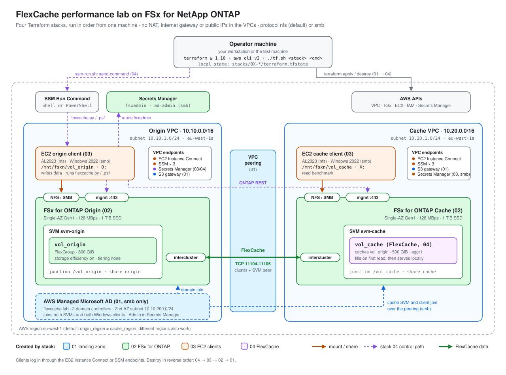

# FlexCache performance testing on FSx for NetApp ONTAP

Terraform automation that builds an **FSx for ONTAP Origin** and an **FSx for ONTAP Cache**, adds a
Linux test client on each side, and connects the two file systems with **FlexCache**.

- **Layers you deploy one at a time:** four stacks, each with its own state.
- **Origin, Cache or both:** two switches in `common.tfvars`.
- **Runs from your Mac:** the Terraform state stays there. There is no bastion host and no VPN; the
  VPCs have no internet access, NAT gateway or public IPs.
- **FlexCache is configured from the origin Linux client:** Terraform sends it a script with SSM
  Run Command, and the client creates the cluster peer, SVM peer and FlexCache volume through the
  ONTAP REST API.

<picture>
  <source media="(prefers-color-scheme: dark)" srcset="docs/architecture-dark.svg">
  
</picture>

<details>
<summary>Text version of the diagram</summary>

```
  YOUR MAC  ── terraform, aws cli, local state
     │  AWS APIs (all stacks), SSM Run Command (stack 04)
     │  login to the clients: EC2 Instance Connect or SSM
     ▼
          ORIGIN VPC  10.10.0.0/16                           CACHE VPC  10.20.0.0/16
  ┌──────────────────────────────────────┐            ┌──────────────────────────────────────┐
  │ FSx for ONTAP Origin                 │  peering   │ FSx for ONTAP Cache                  │
  │   svm_origin / vol_origin (FlexGroup)│◄──────────►│   svm_cache / vol_cache (FlexCache)  │
  │          ▲ NFS     ▲ ONTAP REST      │intercluster│          ▲ NFS     ▲ ONTAP REST      │
  │ EC2 origin client ─┴─────────────────┼────────────┼────────────────────┘                 │
  │   /mnt/fsxn/vol_origin               │TCP 11104/5 │ EC2 cache client                     │
  │   runs the FlexCache configuration   │            │   /mnt/fsxn/vol_cache                │
  └──────────────────────────────────────┘            └──────────────────────────────────────┘
          origin_region                                     cache_region (same or different)
```

</details>

## Status

| Stack | What it deploys | Status |
|---|---|---|
| `01-landing-zone` | Network Origin, Network Cache, VPC peering | ✅ ready |
| `02-fsxn` | FSx for ONTAP Origin and Cache, shared fsxadmin secret | ✅ ready |
| `03-ec2` | Linux test client on the Origin and/or Cache | ✅ ready |
| `04-flexcache` | Cluster peer, SVM peer, FlexCache volume (run on the origin client) | ✅ ready |

Nothing has been applied to AWS from this repository yet. Every stack passes `terraform validate`
and offline tests with a mocked AWS provider; the FlexCache script was tested against a simulated
ONTAP REST API (create, re-run, delete, recovery from a half-made peer).

## Run the whole lab, step by step

Everything below runs on your Mac, from the repository folder.

### 1. Get the code and the tools

```bash
git clone https://github.com/PFFernandes/flexcache-perf-testing.git
cd flexcache-perf-testing
brew install hashicorp/tap/terraform awscli
brew install --cask session-manager-plugin      # only for SSM logins to the EC2 clients
```

### 2. Log in to AWS

```bash
aws configure sso                               # once: creates a profile, e.g. "flexcache"
aws sso login --profile flexcache               # whenever the session expires
export AWS_PROFILE=flexcache                    # in every terminal you use
aws sts get-caller-identity                     # must print your account
```

(With access keys instead of SSO: `aws configure --profile flexcache`.)

### 3. Create and edit the settings files

```bash
./scripts/init-tfvars.sh
```

This creates `common.tfvars` and `stacks/<stack>/terraform.tfvars` for every stack from the
`.example` files. It never overwrites a file that already exists (`--force` recreates them and
keeps a `.bak`). Then edit at least `common.tfvars`:

| Setting | Example |
|---|---|
| `creator` | `"pedro"` (lowercase, digits, hyphens; starts every name) |
| `project` | `"flexcache-perf"` |
| `origin_region` / `cache_region` | `"eu-west-1"` |
| `deploy_origin` / `deploy_cache` | `true` / `true` (FlexCache needs both) |
| `origin_azs` / `cache_azs` | `["a"]` (= eu-west-1a) |

Sizes and options of each stack are in its own `terraform.tfvars` (see [Settings](#settings)).

### 4. Deploy the stacks in order

Each stack: `init` once, then `plan` to review, then `apply` (type `yes` to confirm). Every plan
or apply first prints the settings files it loaded, so check the regions there.

| # | Commands | Creates | Time |
|---|---|---|---|
| 1 | `./tf.sh 01-landing-zone init`<br>`./tf.sh 01-landing-zone plan`<br>`./tf.sh 01-landing-zone apply` | Origin and Cache VPCs, subnets, S3 endpoint, peering | ~2 min |
| 2 | `./tf.sh 02-fsxn init`<br>`./tf.sh 02-fsxn plan`<br>`./tf.sh 02-fsxn apply` | FSx for ONTAP Origin + Cache, SVMs, `vol_origin`, fsxadmin secret | 20-40 min, billed hourly |
| 3 | `./tf.sh 03-ec2 init`<br>`./tf.sh 03-ec2 plan`<br>`./tf.sh 03-ec2 apply` | origin and cache EC2 clients, Instance Connect + SSM endpoints | ~5 min |
| 4 | `./tf.sh 04-flexcache init`<br>`./tf.sh 04-flexcache plan`<br>`./tf.sh 04-flexcache apply` | Secrets Manager endpoint, then on the origin client: cluster peer, SVM peer, `vol_cache` | ~5-10 min |

During step 4 the apply prints the log of the origin client, e.g.
`[flexcache] creating cluster peer ...`, `SVM peer state: peered`, `FlexCache vol_cache created`.
Check what each stack created at any time with `./tf.sh <stack> output`.

### 5. Log in to the clients and check the mounts

```bash
./tf.sh 03-ec2 output                           # instance IDs and the exact login commands
aws ec2-instance-connect ssh --instance-id <origin-client-id> --connection-type eice
```

On the origin client (volume root is owned by root, hence `sudo`):

```bash
df -h /mnt/fsxn/vol_origin                      # FSx for ONTAP Origin
sudo touch /mnt/fsxn/vol_origin/hello && ls -l /mnt/fsxn/vol_origin
```

On the cache client:

```bash
df -h /mnt/fsxn/vol_cache                       # FSx for ONTAP Cache, up to a minute after step 4
ls -l /mnt/fsxn/vol_cache                       # shows "hello", served through the cache
```

### 6. Tear everything down

When you're done (FSx for ONTAP is billed every hour), destroy in reverse order. See
[Destroy](#destroy).

## Repository layout

```
.
├── modules/                   building blocks (no backend, no provider config)
│   ├── 01-network-origin/     origin VPC, private subnets, S3 endpoint, optional NAT
│   ├── 02-network-cache/      cache VPC, same as 01
│   ├── 03-vpc-peering/        peering + routes, same- or cross-region
│   ├── 04-fsxn-origin/        FSx for ONTAP Origin: file system, SVM, vol_origin, security group
│   ├── 05-fsxn-cache/         FSx for ONTAP Cache: file system, SVM, security group
│   ├── 06-ec2-client/         Linux client: NFS mounts, EC2 Instance Connect + SSM endpoints
│   └── 07-ontap-flexcache/    FlexCache setup run on the origin client (SSM + ONTAP REST script)
├── stacks/                    what you deploy, one local state file each
│   ├── 01-landing-zone/
│   ├── 02-fsxn/
│   ├── 03-ec2/
│   └── 04-flexcache/
├── scripts/
│   ├── init-tfvars.sh         creates common.tfvars + every stack's terraform.tfvars
│   ├── origin/                dataset generation (planned)
│   └── cache/                 read benchmark (planned)
├── common.tfvars.example      settings shared by every stack
└── tf.sh                      wrapper: ./tf.sh <stack> <command>
```

A **module** is a building block ("how to build one FSx for ONTAP"). A **stack** is something you
deploy, with its own state, that calls modules ("build the Origin, and the Cache if switched on").
Stacks read the outputs of earlier stacks from their local state files.

## Creation order

Stacks and modules are numbered in the order they are created. A number only depends on lower
numbers, so deploy from `01` upwards and destroy from the highest number down.

```
stacks:   01-landing-zone ──► 02-fsxn ──► 03-ec2 ──► 04-flexcache

modules:  01-network-origin ──┐                ┌──► 04-fsxn-origin ──┐
                              ├──► 03-peering ─┤                     ├──► 06-ec2-client ──► 07-ontap-flexcache
          02-network-cache  ──┘                └──► 05-fsxn-cache  ──┘
```

| # | Stack | Reads from | Calls modules |
|---|---|---|---|
| 01 | `01-landing-zone` | – | `01-network-origin`, `02-network-cache`, `03-vpc-peering` |
| 02 | `02-fsxn` | 01: VPCs, subnets, CIDRs | `04-fsxn-origin`, `05-fsxn-cache` |
| 03 | `03-ec2` | 01: subnets · 02: SVM NFS IPs, junction paths | `06-ec2-client` |
| 04 | `04-flexcache` | 01: origin VPC · 02: management/intercluster IPs, SVMs, fsxadmin secret · 03: origin client | `07-ontap-flexcache` |

| # | Module | Side | Needs |
|---|---|---|---|
| 01 | `01-network-origin` | Origin | – |
| 02 | `02-network-cache` | Cache | – (its CIDR must not overlap 01) |
| 03 | `03-vpc-peering` | both | 01 + 02: VPC IDs, route tables, CIDRs |
| 04 | `04-fsxn-origin` | Origin | 01: VPC and subnet · 03: reachability |
| 05 | `05-fsxn-cache` | Cache | 02: VPC and subnet · 03 · the Origin it caches (04) |
| 06 | `06-ec2-client` | both | 01/02: the FSx for ONTAP subnet · 04/05: SVM NFS IP |
| 07 | `07-ontap-flexcache` | both | 04 + 05: management/intercluster IPs, SVMs, origin volume · 06: the origin client runs it |

The cache client's `/mnt/fsxn/vol_cache` is configured in step 3 but only mounts once step 4 has
created the FlexCache volume (a timer on the client retries every minute).

## How FlexCache is configured (stack 04)

The AWS FSx API has no cluster peering or FlexCache calls; they exist only in the ONTAP REST API on
each file system's **management IP**, which is private. So nothing has to reach those IPs from your
Mac: the **origin EC2 client** does the work.

1. `terraform apply` creates a **Secrets Manager endpoint** in the origin VPC and lets the origin
   client's role read the fsxadmin secret.
2. It then runs `modules/07-ontap-flexcache/files/ssm-run.sh` on your Mac, which sends
   `files/flexcache.py` to the origin client with **SSM Run Command** and waits for it.
3. On the client, the script reads the fsxadmin password from Secrets Manager (it is never part of
   the SSM command) and calls the ONTAP REST API on the Origin management IP (same VPC) and the
   Cache management IP (over the peering):
   - **cluster peer** Origin ⇄ Cache over the intercluster IPs, with a one-time passphrase
     generated on the client;
   - **SVM peer** `svm_cache` ⇄ `svm_origin` with the `flexcache` application, accepted on the
     Origin;
   - **FlexCache volume** `vol_cache` on `svm_cache` (500 GiB, `aggr1`), origin `vol_origin`,
     mounted at `/vol_cache`.
4. `terraform destroy` runs the same script with `delete`: FlexCache (unmount, offline, delete),
   SVM peer, cluster peer.

Every step checks what already exists, so re-running is safe. Changing a FlexCache setting
(name, size, path, aggregates) deletes and recreates the FlexCache setup. The origin client needs
SSM (`enable_ssm = true` in `03-ec2`, the default); stack 04 stops with a clear message otherwise.

## Settings

Module variables are never set directly: each stack fills them in. You only edit these files
(all git-ignored). `./scripts/init-tfvars.sh` creates all of them from the `.example` next to them:

| File | Main settings |
|---|---|
| `common.tfvars` (every stack) | `project`, `creator`, `origin_region`, `cache_region`, `deploy_origin`, `deploy_cache`, `origin_azs`, `cache_azs` |
| `stacks/01-landing-zone/terraform.tfvars` | VPC CIDRs, subnet CIDR overrides, `origin_nat_gateway` / `cache_nat_gateway` (default `false`) |
| `stacks/02-fsxn/terraform.tfvars` | `origin_fsxn` / `cache_fsxn` (default SINGLE_AZ_1, 128 MB/s, 1024 GiB), `origin_volume` (default `vol_origin`, FlexGroup, 800 GiB, storage efficiency on) |
| `stacks/03-ec2/terraform.tfvars` | `origin_ec2` / `cache_ec2`, `instance_type` (`t3.small`), `enable_eice` / `enable_ssm`, `nfs_options`, `cache_mounts_origin` |
| `stacks/04-flexcache/terraform.tfvars` | `flexcache_name` (`vol_cache`), `flexcache_size_gib` (500), `flexcache_junction_path`, `cache_aggregates`, `create_secrets_endpoint` |

The stack files are optional; without them every value has a default. `tf.sh` passes
`common.tfvars` to every stack and, before each plan or apply, prints the files it loads and the
regions it uses. The `.example` files themselves are never read.

## Origin, Cache or both

```hcl
# common.tfvars
deploy_origin = true
deploy_cache  = true
```

| What | Stack | Origin only | Cache only | Both |
|---|---|---|---|---|
| Network Origin | `01-landing-zone` | ✅ | | ✅ |
| Network Cache | `01-landing-zone` | | ✅ | ✅ |
| VPC peering | `01-landing-zone` | | | ✅ |
| FSx for ONTAP Origin | `02-fsxn` | ✅ | | ✅ |
| FSx for ONTAP Cache | `02-fsxn` | | ✅ | ✅ |
| EC2 client (also `origin_ec2` / `cache_ec2`) | `03-ec2` | origin client | cache client | both |
| FlexCache (needs the origin client) | `04-flexcache` | | | ✅ |

- After changing a switch, apply the stacks in order (`01`, `02`, `03`, then `04`): each side needs
  its network first. Stacks 02, 03 and 04 stop with a clear error if something is missing.
- Switching a side **on** adds it without touching the other side. Switching it **off** destroys
  that side, so remove what depends on it first (`04-flexcache`, `03-ec2`, then `02-fsxn`, then
  `01-landing-zone`).
- Both switches `false` is rejected.
- Keep the switches in `common.tfvars` rather than passing `-var`, so a later plain `apply` doesn't
  switch a side back off.

## Your Mac

- **Tools:** `brew install hashicorp/tap/terraform awscli` (Terraform ≥ 1.10, AWS CLI v2). For SSM
  logins also `brew install --cask session-manager-plugin`. `bash` and `gzip` come with macOS.
- **AWS credentials:** `export AWS_PROFILE=<profile>`. The profile must be able to create VPCs,
  peering, FSx for ONTAP, EC2 instances and endpoints, IAM roles and policies and Secrets Manager
  secrets, and to use SSM Run Command (`ssm:SendCommand`, `ssm:GetCommandInvocation`). In a sandbox
  account `AdministratorAccess` is simplest (`PowerUserAccess` can't create the IAM role).
- **Every stack only calls AWS APIs**, so all of them work from anywhere with internet. Nothing
  connects from your Mac into the VPCs except your logins through the endpoints.

## The EC2 clients

Each client is an Amazon Linux 2023 instance in the **same private subnet as its side's FSx for
ONTAP**, with the Linux hostname `origin` or `cache`. At boot it adds the NFS mounts to `/etc/fstab`, and a systemd timer retries `mount -a` every
minute, so a volume that doesn't exist yet is mounted within a minute of being created. Each mounted
volume's top directory is set to `1777`, so `ssm-user` (SSM) and `ec2-user` (Instance Connect) can
both write to it:

| Client | Mounts |
|---|---|
| origin | `/mnt/fsxn/vol_origin` ← origin SVM `:/vol_origin` |
| cache | `/mnt/fsxn/vol_cache` ← cache SVM `:/vol_cache` (FlexCache). Optional (`cache_mounts_origin = true`): `/mnt/fsxn/vol_origin` ← origin SVM over the peering, as a no-cache baseline |

Default NFS options: `vers=3,nconnect=8,hard,timeo=600,retrans=2,rsize=1048576,wsize=1048576`
(change with `nfs_options`). The origin client also runs the FlexCache configuration (stack 04).

Log in from your Mac (the exact commands are in `./tf.sh 03-ec2 output`):

```bash
aws ec2-instance-connect ssh --instance-id <id> --connection-type eice   # EC2 Instance Connect Endpoint
aws ssm start-session --target <id>                                      # SSM Session Manager
```

Both endpoints are created per VPC by `06-ec2-client`. The Instance Connect Endpoint may only SSH to
the client; the SSM interface endpoints only accept HTTPS from it. `t3.small` is enough to check the
mounts; use a network-optimised type such as `c6in.xlarge` for real performance numbers.

## Tags and names

Every AWS resource gets two tags: `Creator` (from `creator`, set through the provider
`default_tags`) and `Name`. Every name is `<creator>-<project>-<side>-<object>`:

| Object | Name |
|---|---|
| VPC, subnets | `pedro-flexcache-perf-origin-vpc`, `pedro-flexcache-perf-origin-private-eu-west-1a` |
| Route tables, NAT | `...-origin-private-rt`, `...-origin-nat`, `...-origin-nat-eip` |
| Peering | `pedro-flexcache-perf-origin-to-cache` |
| FSx for ONTAP | `pedro-flexcache-perf-origin-fsxn`, security group `...-origin-fsxn-sg` |
| fsxadmin secret | `pedro-flexcache-perf/fsxadmin` |
| EC2 instances (shorter on purpose: `<creator>-<side>-client`) | `pedro-origin-client`, `pedro-cache-client` |
| EC2 supporting resources | `pedro-flexcache-perf-origin-client-eice`, `...-origin-client-ssm-endpoint`, `...-cache-client-sg` |
| FlexCache (stack 04) | `pedro-flexcache-perf-flexcache-secretsmanager-endpoint`, policy `...-flexcache-read-fsxadmin` |

`creator` may only contain lowercase letters, digits and hyphens, because it is part of every name.

- **Also tagged:** each VPC's default security group, main route table and network ACL (AWS creates
  them untagged; the network modules adopt them), and the clients' root EBS volumes.
- **Not taggable:** routes and route-table associations, IAM inline policies, and the ONTAP objects
  (cluster peer, SVM peer, FlexCache volume).

## State and the fsxadmin password

Each stack writes `stacks/<stack>/terraform.tfstate` on your Mac (git-ignored). It contains the
generated fsxadmin password, so never commit it.

- **One fsxadmin password** for both FSx for ONTAP: `02-fsxn` generates it and stores it in the
  Secrets Manager secret `<creator>-<project>/fsxadmin` in the origin region. To read it:
  `aws secretsmanager get-secret-value --secret-id <creator>-<project>/fsxadmin --region <origin_region>`
- **Keep the state files.** Destroy the lab before you delete the clone, and back the `*.tfstate`
  files up (e.g. Time Machine). Without them Terraform no longer knows what it created.
- Moving to S3 later is a one-file change per stack (`backend.tf`) plus `terraform init -migrate-state`.

## Destroy

Reverse order, highest number first. Each asks for `yes`:

```bash
./tf.sh 04-flexcache destroy        # runs on the origin client: FlexCache, SVM peer, cluster peer
./tf.sh 03-ec2 destroy              # destroy 04 first: it needs the origin client
./tf.sh 02-fsxn destroy             # deletes both FSx for ONTAP and the fsxadmin secret
./tf.sh 01-landing-zone destroy
```

## Network notes

- **Availability Zones** are letters added to the region in `common.tfvars`: `origin_azs = ["a"]`
  and `cache_azs = ["a"]` (default `eu-west-1a`). Each AZ gets one private /24 (`x.x.1.0`,
  `x.x.2.0`, ...). Single-AZ FSx for ONTAP and the EC2 clients use the first AZ; Multi-AZ needs
  two, e.g. `["a", "b"]`.
- **CIDRs** must not overlap (defaults: origin `10.10.0.0/16`, cache `10.20.0.0/16`).
- **No NAT gateway is needed** (off by default): FSx for ONTAP never starts internet traffic, the
  clients reach SSM and Secrets Manager through interface endpoints and Amazon Linux packages
  through the free S3 gateway endpoint. With NAT on, the first AZ also gets a public /24
  (`x.x.101.0`).
- **Security groups** on both FSx for ONTAP allow, from both VPCs: NFS (TCP/UDP 111, 635, 2049,
  4045-4046, UDP 4049), ONTAP management (TCP 443, 22), intercluster (TCP 11104-11105) and ICMP.
  That is what lets the origin client reach the Cache management IP over the peering.
- **Cluster peering and FlexCache** use the intercluster IPs and run over the VPC peering.
- **Single-AZ is the default** because its management and NFS endpoints are normal VPC IPs that
  work across peering. Multi-AZ endpoints use floating IPs that don't route over peering (they
  would need Transit Gateway).

## Costs

- **FSx for ONTAP** is billed per hour for throughput capacity and SSD: destroy `02-fsxn` between
  test campaigns.
- **EC2 clients:** `t3.small` is about USD 0.02/h each.
- **SSM endpoints:** about USD 0.03/h per VPC for the three of them (`enable_ssm = false` to skip;
  the origin client needs them for stack 04).
- **Secrets Manager endpoint** (stack 04, origin VPC): about USD 0.01/h.
- **EC2 Instance Connect Endpoint:** free.
